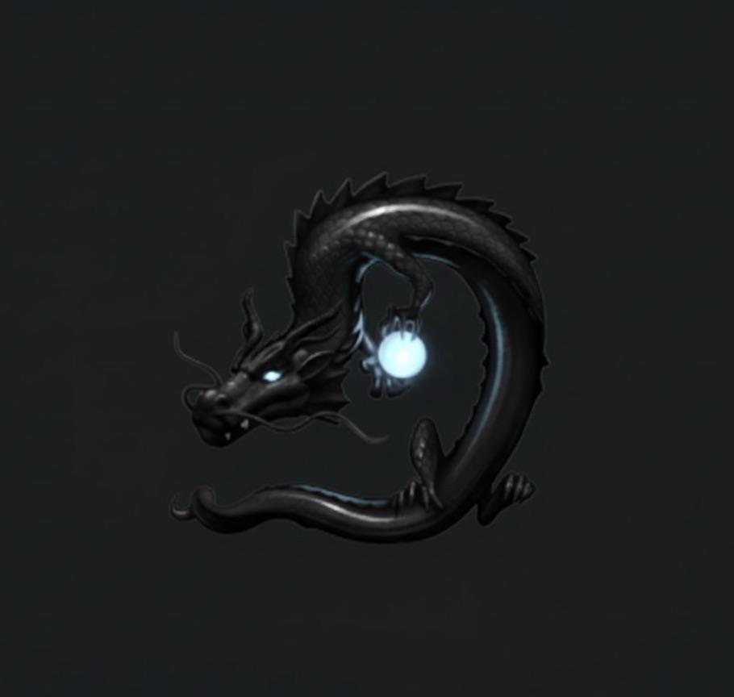

<p align="center">
  
</p>

<h1 align="center">CrypRQ</h1>
<p align="center"><strong>Hybrid post-quantum VPN research</strong><br>Explicit peer trust. Authenticated key establishment. Evidence-first testing.</p>

<p align="center">
  <a href="https://github.com/codethor0/cryprq/actions/workflows/ci.yml"></a>
  <a href="https://github.com/codethor0/cryprq/actions/workflows/dependency-governance.yml"></a>
  <a href="LICENSE"></a>
</p>

> **Research prototype. Not production-ready.** CrypRQ contains a Rust implementation of an authenticated hybrid handshake, a point-to-point VPN link and file transfer built on it, and a web testing stack that runs an older unauthenticated path. It has not been independently audited. A successful build or a green badge is not proof that it has passed a security review.

## What CrypRQ is

CrypRQ explores peer-to-peer encrypted communication combining **ML-KEM-768** and **X25519**, with ChaCha20-Poly1305 records, session key rotation, and explicit trust boundaries. The project consists of a Rust CLI, cryptographic and networking crates, a libp2p/QUIC transport, and a React/TypeScript web testing interface.

The design goal is a secure, practical VPN with evidence-based verification. **The full end-to-end VPN goal is still in progress.** The versioned, mutually authenticated handshake is distinct from the legacy libp2p/QUIC path that the web preview uses. Do not interpret a libp2p connection event as proof that CrypRQ's hybrid handshake has finished.

## Implementation status

Snapshot: **November 2026**.

| Component | Status | Evidence and limits |
| --- | --- | --- |
| Authenticated handshake | Implemented | Pinned Ed25519 identities, ML-KEM-768 + X25519, transcript binding and key confirmation in both directions. Unit tests and two-process tests |
| Authenticated file transfer | Implemented | UDP tunnel between pinned peers; the receiver verifies size and SHA-256, publishes atomically without overwriting, rejects unsafe names and symlinks, and bounds size, concurrent transfers and reserved storage |
| Authenticated VPN link (`--vpn`) | Implemented as a **point-to-point link** | Tested between two processes and between Linux TUN devices in containers. Installs no routes, no DNS settings and no leak protection. macOS TUN devices are **untested** |
| Web UI and Docker lab stack | **Test-mode preview** | Runs the legacy libp2p path without the CrypRQ handshake and without peer authentication |
| Legacy libp2p/QUIC listener and dialer | Prototype transport | A connection is **not** an authenticated hybrid tunnel and carries no tunnel traffic |
| Dependency and CI gates | In place | `cargo deny`, `cargo audit` and `npm audit` report no findings on the locked dependencies and no advisory is ignored; see [Security Notes](docs/SECURITY_NOTES.md). Routine Dependabot version updates are paused, see [deferred updates](docs/DEFERRED_DEPENDENCY_UPDATES.md) |

**Verification boundary:** the results quoted in this repository were obtained on developer machines (macOS and Linux containers) with the scripts listed under "Validation and CI". Check the workflow runs for what hosted CI has actually executed. Do not use these results as a production assurance statement.

## Architecture at a glance

```text
Web lab UI (React / TypeScript) -> Node.js web server -> Rust CLI (test-mode preview)

Rust CLI
  |-- crypto / core : ML-KEM-768, X25519, KDF, authenticated record format
  |-- node          : identities, pinned peers, sessions, records, transfer receiver
  |-- p2p           : libp2p / QUIC transport
  `-- CLI modes     : lab listener/dialer, file transfer, experimental VPN
```

The [`crypto/`](crypto/), [`core/`](core/), [`node/`](node/), [`p2p/`](p2p/), and [`cli/`](cli/) directories contain the Rust implementation. The [`web/`](web/) directory contains the browser interface and backend. The authenticated handshake and the VPN link are specified in [`docs/HANDSHAKE_V2.md`](docs/HANDSHAKE_V2.md).

## Quickstart: local web lab

**For evaluation only.** The web preview runs the legacy libp2p path: it does not run the CrypRQ hybrid handshake and does not authenticate peers. Do not expose it as a production VPN, use it to protect sensitive traffic, or assume authenticated peers.

```bash
git clone https://github.com/codethor0/cryprq.git
cd cryprq
docker compose -f docker-compose.web.yml up --build
# Web lab: http://localhost:8787
```

To stop the lab:

```bash
docker compose -f docker-compose.web.yml down
```

The web-specific setup and limitations are in [Docker Web Guide](docs/DOCKER_WEB_GUIDE.md), [Web Stack Quick Start](docs/WEB_STACK_QUICK_START.md), and [Security Notes](docs/SECURITY_NOTES.md). Those documents describe historical preview behavior and should not be mistaken for a current production deployment guide.

## Authenticated file transfer

Run only in an isolated test environment.

```bash
cargo build --release --locked -p cryprq

# On each separate node: explicitly provision an identity and print its public key.
./target/release/cryprq identity init
./target/release/cryprq identity show

# Exchange public keys over a trusted out-of-band channel.
# Add each other node's key to that node's ~/.cryprq/trusted_peers file.

# Receiver (node B):
./target/release/cryprq receive-file \
  --listen /ip4/0.0.0.0/udp/20440 \
  --output-dir ./inbox

# Sender (node A):
./target/release/cryprq send-file \
  --peer /ip4/203.0.113.7/udp/20440 \
  --file ./example.txt \
  --peer-key ed25519:<RECEIVER_PUBLIC_KEY_HEX>
```

Replace the documentation-only address and key placeholders with the actual receiver's address and pinned public key. When testing two nodes on one host, provide separate `--identity` and `--trusted-peers` paths; do not reuse one identity for both ends. An empty trust file denies connections. `--test-mode` uses publicly known keys, is **not secure**, and is refused unless `CRYPRQ_TEST_MODE=1` is also set.

The exact wire layout, key schedule, identity-file format, test-mode rules, and constraints are in the [handshake v2 design](docs/HANDSHAKE_V2.md).

**Current transfer limitations:** one receiver session per process; no application-level delivery acknowledgment or retransmission. The receiver verifies the announced size and SHA-256 and publishes atomically; a sender completing transmission still does not prove that the receiver published the file.

## Security model and boundaries

| Property | Research implementation / limitation |
| --- | --- |
| Confidentiality | The handshake derives hybrid session material from ML-KEM-768 and X25519 and uses authenticated record encryption. This is not yet an audited production VPN. |
| Peer authorization | Each node has a persistent Ed25519 identity and explicitly pins peer public keys. Empty trust means deny; there is no automatic trust on first use. |
| Key confirmation | The handshake binds messages and identities to an authenticated transcript before permitting application data. |
| Record protection | The protocol work tests nonce exhaustion, direction-specific keys, replay rejection and epoch handling. Host-level routing and leak behavior require separate tests. |
| Quantum-security scope | **Ed25519 authentication is classical**, not post-quantum. Hybrid confidentiality does not make the entire system post-quantum secure against every threat. |
| Test mode | The historical web preview and explicit fixed-key CLI test paths are for isolated labs only. They do not establish peer authentication. |
| Local discovery | None. mDNS is not compiled and peers are given explicit addresses. |
| Supply chain | ML-KEM-768 comes from the RustCrypto `ml-kem` crate and is checked against NIST ACVP vectors. `cargo deny`, `cargo audit` and `npm audit` run in CI without exceptions. A clean scan covers known advisories only; the dependencies have not been audited by this project. |

Do not treat this project as independently audited or production-approved. For reporting a potential vulnerability, contact **codethor@gmail.com**. Avoid submitting real private keys, credentials or sensitive packet captures in issues or logs.

## Authenticated VPN link

`--vpn` runs the same handshake over libp2p/QUIC and carries IP packets only inside the authenticated session. It is a **point-to-point link**: it creates a TUN device and assigns its address, and installs **no routes, no DNS settings and no leak protection**. Verified between Linux TUN devices in containers and between two local processes; **not verified on macOS TUN devices**. Creating a TUN device needs root (or `NET_ADMIN` in a container).

```bash
# Both nodes: provision identities and pin each other, as for file transfer.

# Listener (node B), tunnel address 172.31.250.1/30:
./target/release/cryprq --vpn \
  --listen /ip4/0.0.0.0/udp/9999/quic-v1 \
  --tun-address 172.31.250.1 --tun-netmask 255.255.255.252

# Dialer (node A), tunnel address 172.31.250.2/30:
./target/release/cryprq --vpn \
  --peer /ip4/203.0.113.7/udp/9999/quic-v1 \
  --tun-address 172.31.250.2 --tun-netmask 255.255.255.252
```

Choose a tunnel subnet that is unused on both hosts; on macOS, `scripts/vpn_preflight_macos.py` checks a candidate without changing anything. Without root, `--packet-bridge 127.0.0.1:PORT` exchanges IP packets with a loopback UDP socket instead of a TUN device, which is what the two-process test uses. Details and limitations: [handshake and VPN link design](docs/HANDSHAKE_V2.md).

## Validation and CI

Run the relevant checks and inspect failures rather than bypassing them:

```bash
cargo fmt --all -- --check
cargo clippy --workspace --all-targets --all-features -- -D warnings
cargo test --workspace --all-features --locked
```

The toolchain is pinned in [`rust-toolchain.toml`](rust-toolchain.toml) (Rust 1.88.0).

The two-process security tests:

```bash
cargo build --release --locked -p cryprq
bash scripts/e2e-authenticated-file-transfer.sh ./target/release/cryprq
bash scripts/e2e-authenticated-vpn.sh ./target/release/cryprq
```

The device test needs Docker and runs both endpoints on real TUN devices in two containers on an internal network, without touching the host's network:

```bash
bash scripts/e2e-tun-docker.sh
```

The E2E workflow runs these scripts as the `Authenticated VPN E2E` job and the container TUN test as a second job; see [CI gates for the VPN](docs/CI_VPN_GATES.md) and the [E2E coverage map](docs/E2E_COVERAGE_MAP.md). Host-level routing and leak tests are still required before a full release claim.

GitHub workflows: [CI](https://github.com/codethor0/cryprq/actions/workflows/ci.yml), [Dependency Governance](https://github.com/codethor0/cryprq/actions/workflows/dependency-governance.yml), [E2E Tests](https://github.com/codethor0/cryprq/actions/workflows/e2e-tests.yml), and [Stability Monitor](https://github.com/codethor0/cryprq/actions/workflows/stability-monitor.yml).

## Documentation and project tracking

- [Architecture and threat model](docs/ARCHITECTURE_AND_THREAT_MODEL.md): existing architectural overview; parts predate the authenticated handshake.
- [Security notes](docs/SECURITY_NOTES.md): implementation status, unauthenticated paths that still exist, and open findings.
- [Protocol v1 research specification](cryp-rq-protocol-v1.md): design reference, not proof of the current operational implementation.
- [Handshake v2 specification](docs/HANDSHAKE_V2.md): the authenticated handshake and VPN link design.
- [File-transfer test plan](docs/FILE_TRANSFER_TEST_PLAN.md) and [VPN routing/leak test plan](docs/VPN_LEAK_AND_ROUTING_TEST_PLAN.md): verification checklists.
- [Release checklist](docs/RELEASE_CHECKLIST.md) and [troubleshooting guide](docs/TROUBLESHOOTING_SUPPORT_BUNDLE.md): release and operational references; validate against the revision being tested.
- [CI gates](docs/CI_VPN_GATES.md) and [E2E coverage map](docs/E2E_COVERAGE_MAP.md): what CI runs and which test asserts which claim.

## Contributing and branch safety

Use short-lived, focused pull requests against `main`. Check the actual workflow results, relevant tests, and cryptographic signatures before integration. Do not bypass a failing security check to make a dashboard appear green.

## License and research support

Source code is provided under the [MIT License](LICENSE). The CrypRQ dragon logo is **copyright 2025 Thor Thor** and is **not** licensed for reuse under the source-code license.

CrypRQ is an independent [THOR-SEC](https://codethor0.github.io/thor-sec/) security research project maintained by [codethor0](https://github.com/codethor0). [Support independent research on GitHub Sponsors](https://github.com/sponsors/codethor0).
